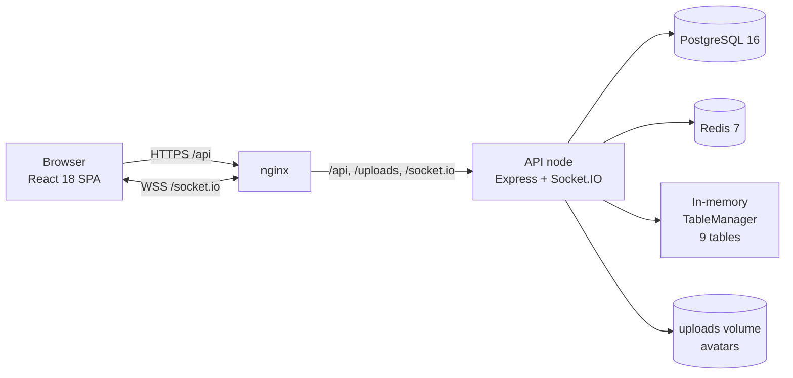
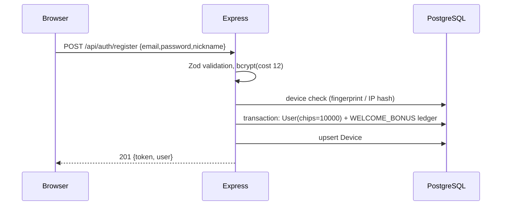
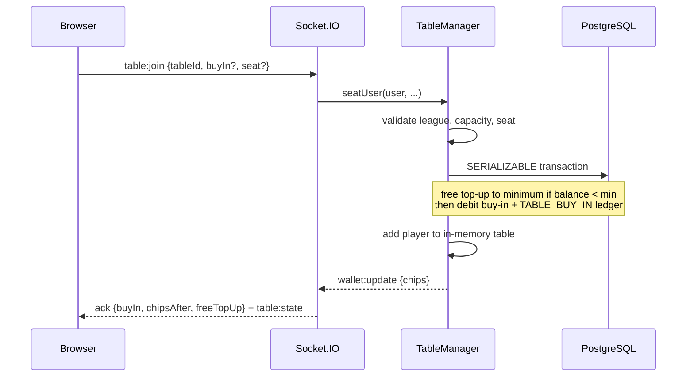

# Architecture

This document describes how Chips Poker is put together, how a hand flows from
the browser to the authoritative engine, how durability and scaling work, and
where the limits of the current design are.

---

## 1. System overview



- **nginx** serves the built SPA and reverse-proxies the API, uploaded avatars and
  the WebSocket handshake. Everything is same-origin in production, which keeps
  CORS, cookies and WebSocket upgrades simple.
- **API node** hosts Express (REST) and Socket.IO (real-time). It is stateless for
  authentication and leaderboards, and stateful only for live tables.
- **PostgreSQL** is the source of truth for users, wallets, chip ledger, hand
  history and statistics.
- **Redis** is optional at runtime. It backs the Socket.IO adapter (fan-out
  between nodes) and a 45-second leaderboard cache. Without it, the API still
  works as a single node and queries the database directly.
- **TableManager** owns nine in-memory `TableRuntime` instances (see
  [tables](../apps/server/src/game/tables.ts)). No game decision touches the
  database on the hot path.

### Why the engine is in memory

A poker action must be validated against the whole table state — stacks, bets,
fold status, side pots, min-raise, who has acted. Doing that in PostgreSQL on
every action would add tens of milliseconds and constant locking. Instead:

- The server is the only authority; clients send intents (`call`, `raise`), never
  stacks or pot sizes.
- Each state transition mutates the in-memory engine synchronously, increments a
  revision, and broadcasts a personalised snapshot.
- Durable facts (wallet movements, completed hands, stats) are written
  asynchronously after the game state has already advanced; the UI never waits
  for a database round trip.

---

## 2. Request and real-time flows

### 2.1 Registration and login



- The device cookie is HttpOnly, signed with `DEVICE_COOKIE_SECRET`, and contains
  a random fingerprint. A fingerprint already linked to an account blocks new
  registrations unless `ALLOW_MULTI_ACCOUNT=true`. Accounts per IP in 24 h are
  soft-limited.
- JWTs carry `sub`, `ver` (token version) and expiry. A password reset increments
  `User.tokenVersion`, so old tokens fail both REST and socket authentication.

### 2.2 Sitting down and buying in



- The buy-in is clamped to `[minBuyIn, maxBuyIn]` and to the player's balance.
  When the balance is below the minimum, the server first grants the exact
  shortfall (ledger type `FREE_TOP_UP`) and then debits the buy-in. This is the
  only free-chip path besides the welcome bonus.
- If the player is already seated at the same table, the join is idempotent:
  it re-sends state and never charges again. This makes reconnects and React
  navigation races safe.
- Leaving is deferred until the current hand ends (`pendingLeave`), preventing
  a player from dodging a pot they have already committed to.

### 2.3 A hand

1. `TableRuntime` rotates the button among eligible seats, posts blinds, deals two
   hole cards per player from a cryptographic Fisher–Yates shuffled deck.
2. The engine computes legal actions, minimum raise and the acting seat.
3. Each action is applied synchronously. The runtime emits `state`, the gateway
   increments the table room broadcast. Only the acting player's legal actions
   and the requester's hole cards are included per socket.
4. A per-turn timer (`TURN_TIMEOUT_MS`, 15–30 s) auto-checks if legal, otherwise
   folds. Timeouts are cleared on action and on shutdown.
5. When the betting round closes, the engine deals the flop/turn/river, or runs
   out the board when all remaining players are all-in.
6. At showdown the evaluator ranks the best five of seven cards, builds main and
   side pots, splits ties and pays winners. Losing hands are mucked; only
   showdown winners' cards are exposed.
7. The runtime emits `handCompleted`; `TableManager` writes the `Hand` and
   `HandParticipant` rows and increments user stats asynchronously. A short
   `NEXT_HAND_DELAY_MS` pause follows before the next hand.

### 2.4 Leaving and cashing out

- When a player leaves (or is removed after a hand), the runtime emits `cashout`
  with the remaining stack. `TableManager.cashOut` adds it back to `User.chips`
  in a serializable transaction and writes a `TABLE_CASH_OUT` row.
- If the process dies between buy-in and cash-out, the next startup calls
  `recoverTableStakes()`. It finds buy-ins that occurred after each user's last
  `TABLE_CASH_OUT` (the trailing, unclosed session) and refunds exactly that run
  as `TABLE_CASH_OUT` rows with reference `startup-recovery`. A zero stack still
  writes a closing row, so a normal bust is not mistaken for a crash. The refund
  is itself a ledger row, so repeating the operation cannot double-credit. Set
  `RECOVER_TABLE_STAKES=false` on a multi-node deployment where another node may
  still own a live table.

---

## 3. Backend modules

| Module | Responsibility |
| --- | --- |
| `config.ts` | Zod-validated environment; fails fast at boot. |
| `app.ts` | Helmet, CORS, pino logging, device cookie, rate limits, routes, static uploads. |
| `auth/` | Register/login, bcrypt, JWT, reset tokens, device checks, auth middleware. |
| `profile/` | Profile stats, hand history, nickname/preset updates, avatar upload. |
| `lobby/` | Table list, league locks, live counts and average stacks. |
| `leaderboard/` | Top-100 all-time/week/today, optional league filter, 45 s cache. |
| `game/deck.ts` | Cryptographic shuffle (`crypto.randomInt`). |
| `game/evaluator.ts` | 7-card evaluator returning category, ranks and a human label. |
| `game/engine.ts` | Pure(ish) Hold'em state machine: streets, betting, side pots, payouts. |
| `game/table-runtime.ts` | One live table: seating, timers, chat, revisioned state, results. |
| `game/table-manager.ts` | Table registry, wallet transactions, hand persistence, startup recovery. |
| `realtime/gateway.ts` | JWT handshake, room management, event validation, broadcasts. |
| `redis.ts` / `cache.ts` | Optional Redis adapter and TTL cache with invalidation. |

### Engine invariants

- A player can only act when it is their turn and they are active (not folded,
  all-in, sitting out or disconnected beyond the grace behavior).
- `call` is capped at the player's stack; `bet`/`raise` must respect the minimum
  raise and the stack. An all-in below a full raise does **not** reopen betting
  for players who already acted.
- Side pots are built from each player's total commitment per hand, with folded
  contributions included in the pots but ineligible to win.
- Odd chips from a split pot go to the first eligible seat left of the button.
- Pots are zero-sum: total payouts equal total commitments.
- The deck is shuffled with `crypto.randomInt`, not `Math.random`.

---

## 4. Data model

```
User ──< Device
 │
 ├──< PasswordResetToken
 ├──< ChipTransaction
 └──< HandParticipant >── Hand

HandParticipant: one row per player per hand (stack, commitment, payout,
                 hole cards, result, best hand, playedAt)
```

Key fields:

| Table | Important fields | Purpose |
| --- | --- | --- |
| `User` | `chips`, `totalWon`, `totalLost`, `handsPlayed`, `handsWon`, `nicknameKey`, `tokenVersion` | Bankroll, stats, case-insensitive nickname, token invalidation |
| `Device` | `fingerprint`, `ipHash`, `firstSeenAt` | Multi-account checks and audit trail |
| `ChipTransaction` | `type`, `amount`, `balanceAfter`, `reference`, `metadata` | Append-only economy ledger |
| `Hand` | `tableId`, `league`, `board`, `pot`, `startedAt`, `endedAt` | Hand archive |
| `HandParticipant` | `committed`, `wonAmount`, `netAmount`, `result`, `playedAt` | History, per-period leaderboards |

`BigInt` is used for all chip columns. The API serializes them to JS numbers with
a `2^53-1` cap to avoid precision surprises; play-money values never approach it.

Indexes that matter:

- `User(totalWon desc)` — all-time leaderboard.
- `HandParticipant(playedAt, wonAmount)` and `(userId, playedAt desc)` — daily and
  weekly leaderboards plus profile history.
- `ChipTransaction(userId, createdAt desc)` — ledger view.
- `Device(fingerprint)` and `(ipHash, firstSeenAt)` — registration checks.

The initial migration lives at
`apps/server/prisma/migrations/20260101000000_init/migration.sql` and is applied
automatically by the server container (`prisma migrate deploy`).

### Leaderboards

- **All time:** `User.totalWon`, only players with `totalWon > 0`.
- **Week / today:** sum of `HandParticipant.wonAmount` since the period start,
  grouped by user; today starts at 00:00 UTC, week is a rolling 7 days.
- League filtering uses lifetime `totalWon` boundaries, matching league access.
- Results are cached in memory/Redis for 45 seconds under
  `leaderboard:v1:<period>:<league>` and invalidated on wallet and hand writes.

---

## 5. Concurrency, consistency and failure handling

- **Wallet transactions** use `Serializable` isolation. A buy-in reads the
  balance, applies a possible top-up, debits the buy-in and writes both ledger
  rows in one transaction. Two simultaneous joins cannot double-spend.
- **Table membership** is guarded in memory (`userTables`), so one user cannot be
  seated twice. A seat race after the wallet transaction is compensated with a
  cash-out.
- **Broadcast fan-out** is scoped to `table:<id>` rooms. The gateway fetches the
  room's sockets and emits a snapshot personalised per user, so private hole
  cards never leak. Table state carries a `revision` for ordering.
- **Timers** are owned by `TableRuntime`; all are cleared when the table stops or
  the process shuts down. Shutdown closes Socket.IO and HTTP, then disconnects
  Prisma and Redis.
- **Persistence is best-effort after the fact.** A failed hand write is logged and
  does not block the table. On restart, live stacks are gone but the ledger is
  reconciled as described above, and bankrolls/stats remain durable.
- **Redis is optional.** If it is unreachable, `initRedis` logs a warning and the
  API continues as a single node without cross-node fan-out.

---

## 6. Scaling to 500 concurrent players

The target load is modest for a single Node process: a few hundred sockets, a
handful of active tables, and state transitions measured in microseconds.

### Baseline (recommended, single node)

- One API container, PostgreSQL, Redis.
- In-memory tables, room-scoped broadcasts, 45 s leaderboard cache.
- REST is only used for auth/profile/lobby/leaderboard; gameplay is WebSocket.
- Expected REST latency is dominated by one indexed PostgreSQL query (usually
  < 10 ms locally); in-memory actions are sub-millisecond plus network.

### Horizontal scale-out

1. **Sessions and sockets:** enable sticky sessions at the load balancer
   (`ip_hash` or cookie-based) and the Redis Socket.IO adapter. Clients on
   different nodes can then receive room broadcasts.
2. **Table ownership:** a table must have exactly one authoritative process.
   Assign tables by consistent hashing or keep a Redis lease per table
   (`SET table:<id>:owner <nodeId> NX PX ...`). Only the owner mutates the engine.
   Other nodes forward actions to the owner over Redis pub/sub or an internal RPC.
3. **Ownership transfer:** on node failure, the lease expires and a new node
   rebuilds the table from the last persisted hand/snapshot. Players reconnect and
   rejoin; their bankroll is durable.
4. **Wallet writes:** PostgreSQL is the bottleneck only at hand boundaries, not
   per action. Batch participant stat updates if throughput grows.
5. **Cache:** Redis already fronts leaderboards; add per-lobby counts if needed.
6. **Uploads:** move avatars to object storage and serve via CDN; the API only
   needs to issue URLs.
7. **Migrations:** run `prisma migrate deploy` as a one-shot job, not from every
   API replica. `RECOVER_TABLE_STAKES` must be disabled or leader-gated.

### Latency budget

| Segment | Typical |
| --- | --- |
| Browser → nginx → API (same region) | 5–30 ms |
| JWT/socket auth | < 1 ms after handshake |
| Action validation + state transition | < 1 ms |
| Personalised broadcast to 9 clients | 1–5 ms |
| Async hand persistence | off the critical path |

The 200 ms target is therefore dominated by network distance, not application
work. The design keeps database writes out of the action path and broadcasts only
to members of the affected table.

---

## 7. Security and anti-abuse

- Server-authoritative game state; no client-supplied stacks, pots or payouts.
- Zod schemas for every body, query and socket payload; unknown fields are
  stripped, sizes bounded.
- Rate limits: 600 requests / 15 min per IP overall, 30 / 15 min on `/auth`.
  Chat is limited to 5 messages / 5 s per socket.
- Socket payload limit 64 kB, JSON body limit 100 kB, avatar limit 2 MB with
  magic-byte image validation and generated filenames (no user-controlled paths).
- Helmet, `x-powered-by` disabled, CORS allow-list, HttpOnly signed device cookie.
- Password reset: 256-bit random token, SHA-256 at rest, one-hour expiry,
  single use, all other tokens revoked, `tokenVersion` bump invalidates JWTs.
- Errors never leak Prisma internals; unique conflicts become a generic 409.
- Device fingerprint + IP hash provide detection, not perfect identity. Shared
  devices are allowed to log in but cannot register a second account by default.
  IP limits are a soft control; document privacy/retention policy before running
  a public deployment.

---

## 8. Known limitations

- Live table state is not snapshotted across process restarts. Stakes are
  refunded, but an interrupted hand is void and chat history is lost.
- Multi-node table ownership/lease transfer is documented but not implemented;
  the shipped deployment runs one game node.
- Email delivery uses SMTP if configured; otherwise reset links are logged in
  development instead of being sent.
- Leaderboards recompute aggregates for week/today; at much larger scale this
  should move to a rollup table or materialized view.
